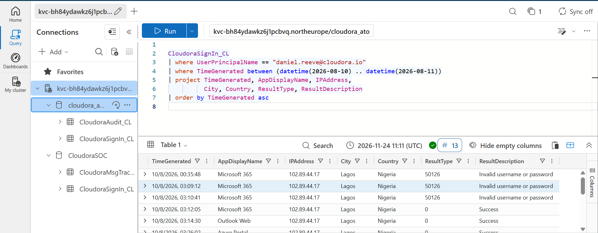
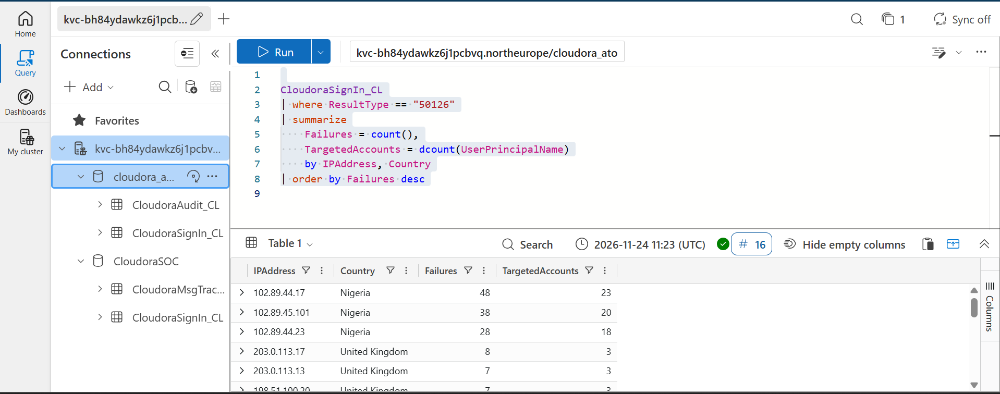
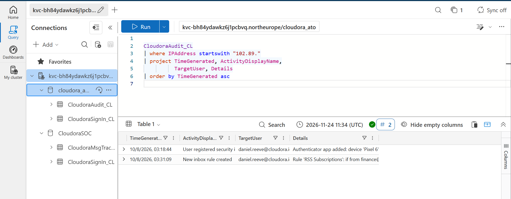
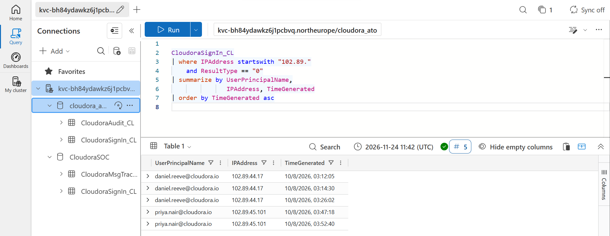
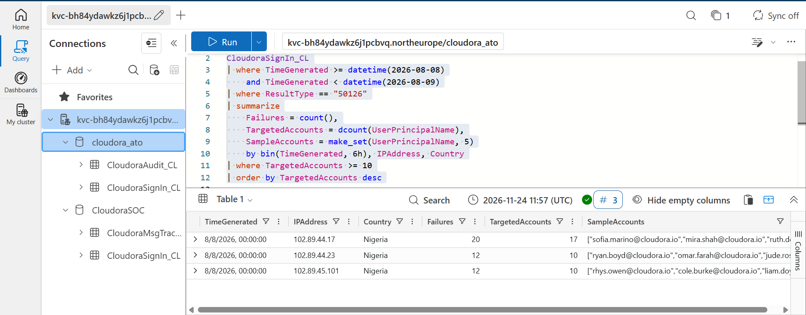
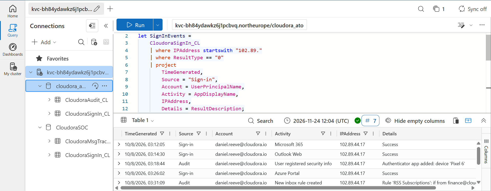

# CEO Account Takeover Investigation | SOC Case Study

## Project Overview

This project documents a simulated Security Operations Centre (SOC) investigation into a CEO account takeover at Cloudora, a fictional organisation.

The investigation was completed as part of the MyFirstHack SOC practical training programme.

Using Microsoft Entra ID sign-in logs, audit logs, Azure Data Explorer and Kusto Query Language (KQL), I investigated a password-spraying campaign, unauthorised account access, authentication-method registration and suspicious mailbox activity.

The project focuses on incident investigation, threat hunting, detection engineering and security reporting.

> **Disclaimer:** This is a simulated cybersecurity training project using fictional company data. No live organisation was investigated, and no production containment actions were performed.

## Tools and Technologies

- Azure Data Explorer
- Kusto Query Language (KQL)
- Microsoft Entra ID authentication and audit log datasets
- MITRE ATT&CK Framework
- Microsoft 365 security concepts
- GitHub for technical documentation

## Investigation Objectives

1. Investigate a suspicious CEO sign-in.
2. Establish normal user authentication behaviour.
3. Identify password-spraying activity.
4. Investigate unauthorised MFA registration and suspicious mailbox rules.
5. Identify additional compromised and targeted accounts.
6. Develop and test a password-spray detection query.
7. Distinguish malicious activity from legitimate travel.
8. Reconstruct the incident timeline and document findings.

## Incident Summary

Between 8 and 10 August 2026, attacker-associated IP addresses generated 114 failed authentication attempts across 26 Cloudora employee accounts.

The investigation identified evidence of unauthorised access to two accounts, including the CEO's Microsoft 365 account.

Post-compromise activity included registration of a new authenticator and creation of a suspicious inbox rule designed to conceal finance-related messages.

The available logs did not establish whether data was exfiltrated or fraudulent payments occurred.

## Key Investigation Findings

| Finding | Evidence |
|---|---|
| Password-spraying campaign | 114 failed attempts across 26 accounts |
| Compromised accounts | 2 accounts with suspicious successful authentication |
| Targeted-only accounts | 24 accounts without observed attacker-origin success |
| MFA persistence | Suspicious authenticator registration |
| Email hiding | Inbox rule affecting finance-related messages |
| Detection engineering | Historical six-hour KQL password-spray detection test |
| False-positive analysis | Dubai sign-ins consistent with legitimate travel |

## MITRE ATT&CK Mapping

| Technique | Description |
|---|---|
| T1110.003 | Password Spraying |
| T1078 | Valid Accounts |
| T1098.005 | Device Registration |
| T1564.008 | Email Hiding Rules |

## KQL Investigation Queries

The [`queries`](queries/) folder contains:

- [CEO Sign-in Investigation](queries/ceo_signin_investigation.kql)
- [Password-Spray Analysis](queries/password_spray_analysis.kql)
- [Account Scoping](queries/account_scoping.kql)
- [MFA Persistence Investigation](queries/mfa_persistence_investigation.kql)
- [Password-Spray Detection](queries/password_spray_detection.kql)
- [Combined Incident Timeline](queries/incident_timeline.kql)

These queries document the investigation methodology and detection logic used with the simulated datasets.

## Investigation Evidence

### 1. CEO Sign-in Investigation

### 2. Password-Spraying Analysis

### 3. MFA Persistence and Malicious Inbox Rule

### 4. Additional Compromised Account

### 5. Password-Spray Detection Engineering

### 6. Combined Incident Timeline

Additional supporting screenshots are available in the [`screenshots`](screenshots/) folder.

## Incident Report

The completed incident report is available in the [`report`](report/) folder.

It includes the executive summary, investigation timeline, findings, indicators of compromise, MITRE ATT&CK mapping, affected accounts, response recommendations and lessons learned.

## Skills Developed

- SOC alert triage and investigation
- Microsoft Entra ID log analysis
- KQL query development
- Password-spraying detection
- Account takeover investigation
- Threat hunting and incident scoping
- MFA and mailbox persistence analysis
- False-positive assessment
- MITRE ATT&CK mapping
- Incident documentation and reporting

## Key Takeaways

This investigation reinforced the importance of correlating authentication events with subsequent account activity.

An unusual login alone does not establish compromise. Examining failed authentication patterns, successful access, authentication-method changes and mailbox modifications provides stronger evidence.

I also learned how to distinguish targeted accounts from compromised accounts and how historical log analysis can support the development of proactive detection rules.

---

**Project type:** Simulated SOC investigation

**Training:** MyFirstHack SOC Practical Programme
